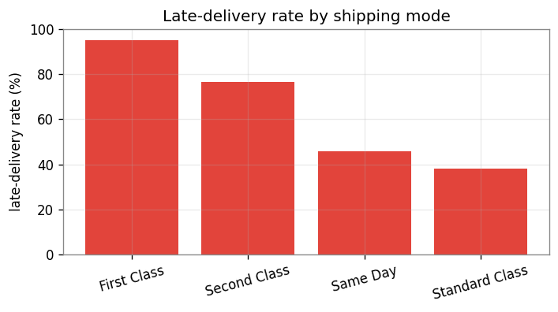
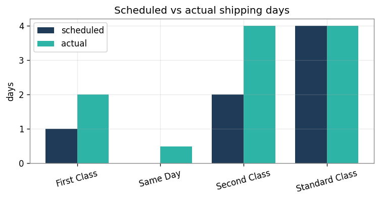
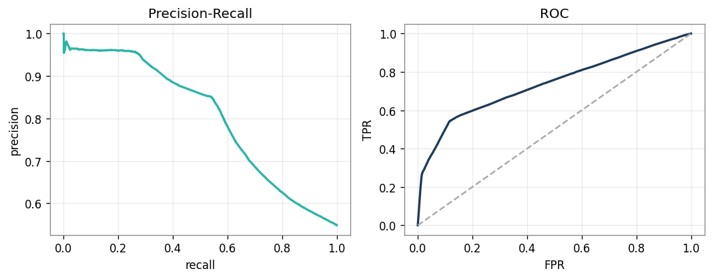
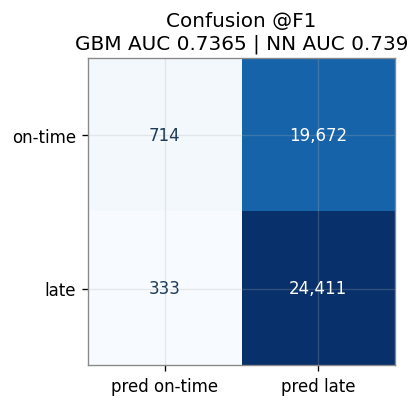
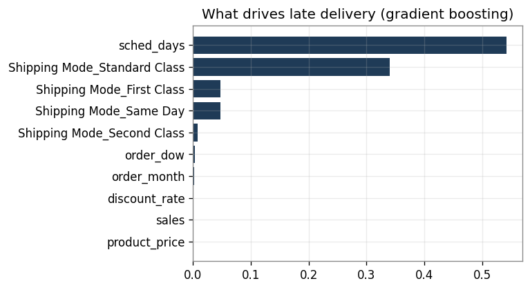
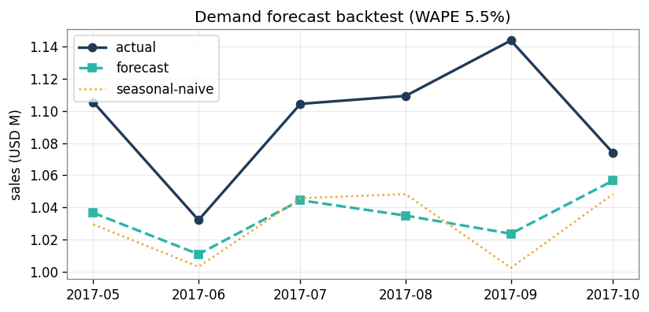
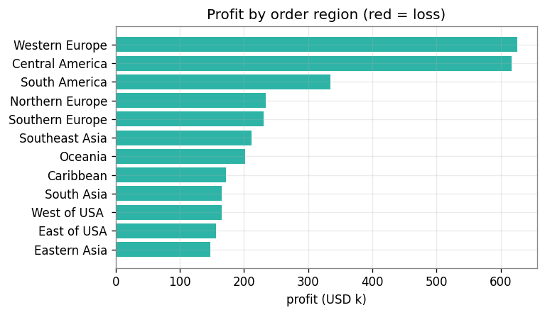
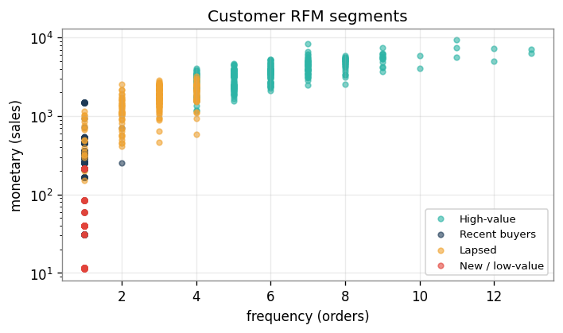

# Supply Chain & Delivery Intelligence

Analytics on the public **DataCo Smart Supply Chain** dataset (180,519 order lines, January 2015 to January 2018, five markets): a **late-delivery risk model** (gradient boosting and a neural network), shipping-performance analysis, profit and cost-to-serve analysis, demand forecasting, and customer RFM segmentation.

**Stack:** Python (pandas, scikit-learn, TensorFlow/Keras, statsmodels, SciPy) · SQL (DuckDB) · Power BI (DAX) · Excel. No API keys or paid tools.

> **Governance and leakage.** Personal data (customer names, email, password, street) is dropped on load. To predict lateness *at order time*, post-shipment fields (`Days for shipping (real)`, `Delivery Status`, `shipping date`) are **excluded** from the model, since they are only known after delivery; they are used only for the descriptive shipping analysis. Details in [`docs/DATA_NOTE.md`](docs/DATA_NOTE.md).

---

## Key results

| Area | Result |
|---|---|
| Late-delivery model (pre-shipment features, isotonic-calibrated) | gradient boosting **ROC-AUC 0.737**, PR-AUC 0.802 (late base rate 54.8%); Keras neural network **0.739**, essentially the same |
| Usable operating points | about **93% precision at 30% recall**, **86% at 50%**, 70% at 68% (read from the precision-recall curve) |
| Shipping mode | late rate: First Class **95.3%**, Second Class 76.6%, Same Day 45.7%, Standard Class 38.1% (chi-square, Cramér's V 0.46) |
| Geography | lateness barely varies by market (54.4% to 55.2%) |
| On-time performance | only **40.9%** of order lines arrive on time |
| Profitability | $36.8M sales, $3.97M profit, **10.8% margin** |
| Cost-to-serve leak | **18.7%** of order lines lose money, a **$3.88M** drag |
| Demand forecast (Holt-Winters, 6-month backtest) | **WAPE 5.5%** vs 6.0% for a seasonal-naive baseline, a modest edge |

**On the F1-optimal threshold.** Because late deliveries are the majority class (55%), the F1-optimal threshold simply flags almost every order (recall 0.99, precision 0.55). The operating points above are more useful; the confusion matrix below uses the F1 threshold for completeness.

**On the shipping-mode result.** It reflects how this dataset schedules shipments: First Class is scheduled at 1.0 day and takes 2.0, Second Class 2.0 vs 4.0, while Standard Class takes exactly its scheduled 4.0 days. Treat it as a description of this data, not a general claim about carriers.

---

## Visuals

**Delivery performance**




**Late-delivery model (pre-shipment features only)**





**Demand and profit**




**Customer segments (RFM, KMeans)**



| Segment | Customers | Avg. days since last order | Avg. orders | Avg. spend |
|---|---|---|---|---|
| High-value | 7,571 | 255 | 5.9 | $3,572 |
| Lapsed | 4,649 | 452 | 2.7 | $1,555 |
| Recent buyers | 5,947 | 77 | 1.0 | $396 |
| New / low-value | 2,485 | 31 | 1.0 | $63 |

Clusters are named from their recency and spend profile; recency is measured against the last order date in the data.

---

## Modules

| # | Module | What it does |
|---|---|---|
| 1 | `clean_validate.py` | loads data, drops PII, validates it, builds leakage-free features |
| 2 | `stats_experiments.py` | shipping mode vs lateness (chi-square), lateness by market, profit by segment (Kruskal-Wallis), discount vs profit (Spearman) |
| 3 | `late_delivery_model.py` | calibrated gradient boosting plus a neural-network benchmark; scores every order |
| 4 | `demand_forecast.py` | Holt-Winters monthly forecast vs a seasonal-naive baseline |
| 5 | `profit_costtoserve.py` | margin and loss-order rate by region, segment, and category |
| 6 | `shipping_variance.py` | scheduled vs actual days and on-time rate by shipping mode |
| 7 | `segmentation.py` | RFM customer segments with KMeans |
| 8 | `export_for_powerbi.py` | star-schema CSVs for Power BI and an Excel late-risk review queue |

**Modelling choices.** A neural network was tried first for the demand forecast but did not beat a seasonal baseline on roughly 34 monthly points, so forecasting uses Holt-Winters and the neural network is applied to the late-delivery task, where 180k rows support it (it matches, but does not beat, gradient boosting). Monthly sales drop sharply after October 2017 (about $1.05M a month to $0.63M, $0.50M, and $0.33M), which looks like an incomplete feed, so those months are excluded from the forecast series.

---

## Quickstart

```bash
git clone https://github.com/vijyush/supplychain-delivery-intelligence.git
cd supplychain-delivery-intelligence
pip install -r requirements.txt
```

1. Download `DataCoSupplyChainDataset.csv` from the *DataCo Smart Supply Chain for Big Data Analysis* page on Kaggle and place it in `data/` (the file is ~96 MB and is not stored in this repo).
2. Run the pipeline and the SQL analytics:

```bash
python src/run_all.py      # features, models, forecast, charts, Power BI tables, Excel queue
python sql/run_sql.py      # SQL analytics via DuckDB
```

If `make` is available, `make all` does both. Charts land in `assets/`, metrics in `outputs/`, Power BI tables in `outputs/powerbi/`, and the late-risk queue in `excel/late_risk_review_queue.xlsx`.

The neural network uses TensorFlow/Keras if installed (uncomment `tensorflow` in `requirements.txt`) and otherwise a scikit-learn MLP.

---

## Power BI dashboard

The pipeline exports the data model; the `.pbix` is assembled in Power BI Desktop. [`powerbi/build_guide.md`](powerbi/build_guide.md) covers loading the CSVs and building the pages, [`powerbi/DAX_measures.md`](powerbi/DAX_measures.md) holds the measures (sales, profit, margin, late rate, loss rate), and [`powerbi/theme.json`](powerbi/theme.json) sets the theme. Suggested pages: **Executive** (KPIs, profit by region, sales trend), **Delivery** (late rate by shipping mode, scheduled vs actual days, late-risk queue), and **Profit & Customers** (profit by category, RFM segments).

<!-- Add your dashboard screenshots to assets/ and uncomment:


-->

---

## Repository structure

```
supplychain-delivery-intelligence/
├── README.md · requirements.txt · Makefile · LICENSE
├── data/         raw DataCo CSV (git-ignored) + sample_5k.csv
├── sql/          4 analytical queries + run_sql.py (DuckDB)
├── src/          the 8 modules above + config.py, make_charts.py, run_all.py
├── powerbi/      build_guide.md · DAX_measures.md · theme.json
├── excel/        late_risk_review_queue.xlsx
├── assets/       chart images used in this README
├── docs/         DATA_NOTE.md · BRD.md · process_map.md
├── notebooks/    01_analysis_walkthrough.ipynb
└── outputs/      metrics (JSON), aggregates, Power BI CSVs
```

Large files (the raw CSV, `*.parquet`, `*.npz`) are git-ignored and regenerated by the pipeline.

---

## Limitations

- The late-delivery model is modest (ROC-AUC about 0.74): pre-shipment features carry limited signal beyond shipping mode, and the neural network adds nothing over gradient boosting.
- The forecast beats the seasonal-naive baseline only slightly, on a short and nearly flat series.
- Shipping-mode effects reflect this dataset's scheduling rules (see above).
- Profit figures are the dataset's order-level profit field; no supplier cost data is available, so no purchase-price-variance analysis is attempted.

## Dataset credit

DataCo Smart Supply Chain for Big Data Analysis (Kaggle), by Fabian Constante, Instituto Politécnico de Leiria, Escola Superior de Tecnologia e Gestão.

## Author

**Burra Vijyusha** · IIT Indore · [GitHub](https://github.com/vijyush) · [LinkedIn](https://www.linkedin.com/in/vijyusha-burra-5654a2297/)

Released under the MIT License.
